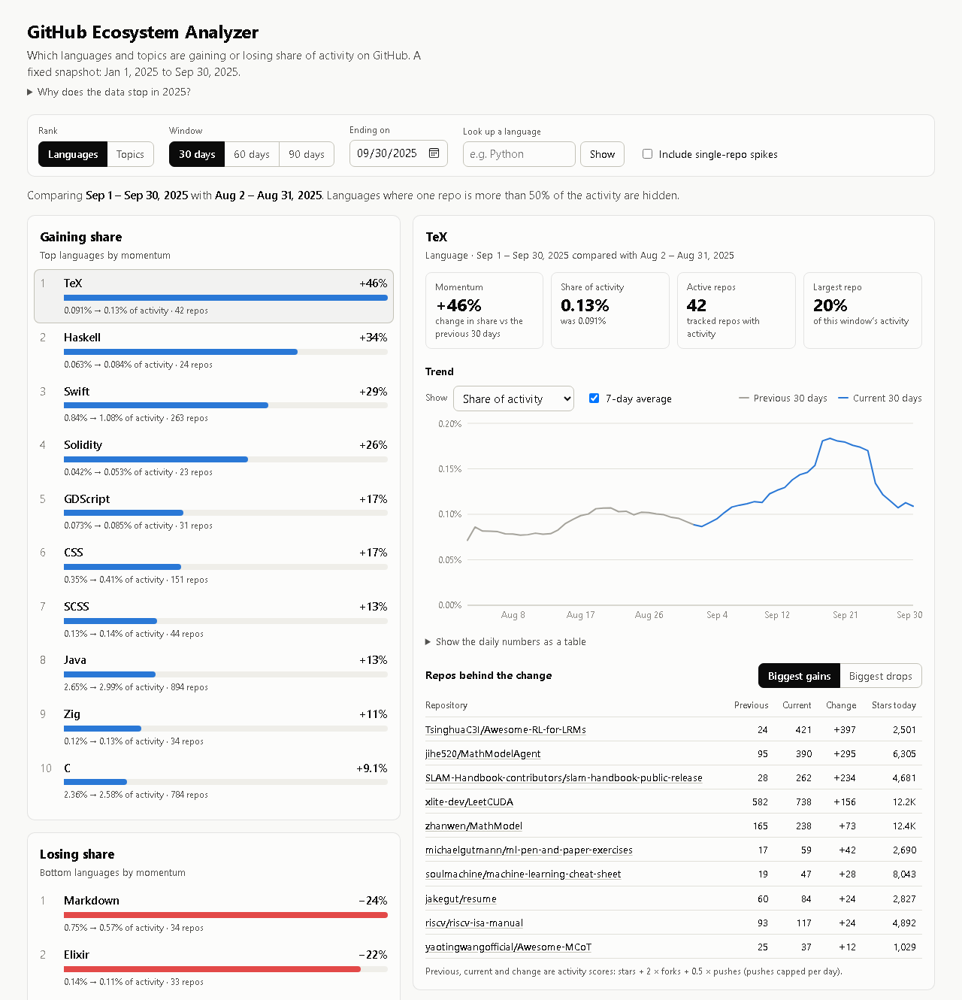
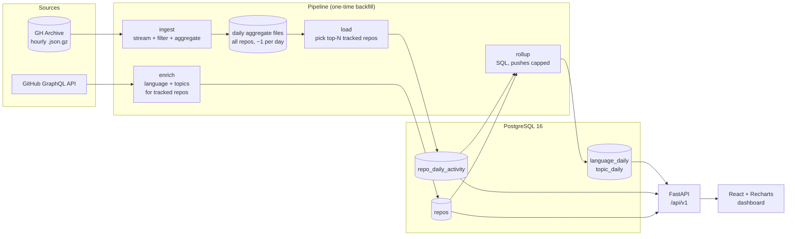

# GitHub Ecosystem Analyzer

[](https://github.com/AksharAeinampudi/gh-ecosystem-analyzer/actions/workflows/ci.yml)

Which languages and topics on GitHub are gaining or losing momentum?

This project reads all public GitHub activity from [GH Archive](https://www.gharchive.org/) (stars, forks, pushes, PRs and issues opened), aggregates it per repo per day, rolls it up by language and topic, and serves a dashboard that ranks technologies by momentum: how much their share of GitHub activity grew over 30, 60 or 90 days compared with the period before.

The dataset is a fixed snapshot, **January–September 2025**. A coverage scan of GH Archive found that from late 2025 its star and fork counts no longer reflect real GitHub activity, and from mid-2026 the data is erratic. The details are in [SPEC §8a](docs/SPEC.md#8a-m1-measurements-2026-11-04).

> Status: M1–M4 done (data pipeline, momentum score, JSON API, dashboard); M5 (deploy and CI) next.

 See [docs/SPEC.md](docs/SPEC.md) for scope, data model, API and milestones.

## Architecture



## How momentum is computed

```
activity  = stars + 2·forks + 0.5·pushes          (per repo per day)
share     = activity of a language / activity of all tracked repos, over a window
momentum  = share in the last W days / share in the W days before − 1
```

Pushes are capped at 25 per repo per day, because a handful of bot repos otherwise make up a tenth of all pushes. A language or topic where one repo is more than half of the current activity is marked as concentrated and left off the leaderboard by default: its momentum describes that repo, not the language.

`W` is 30, 60 or 90 days. Using shares rather than raw totals cancels out changes in how much GH Archive collected (it dropped about 38% across the board in June 2025). The weights are a v1 starting point and get validated against real data in milestone M3 (see [SPEC §4](docs/SPEC.md#4-momentum-score)).

## Stack

| Layer | Tech |
|---|---|
| Ingestion | Python 3.12 scripts (streaming, resumable backfill) |
| Database | PostgreSQL 16 (Docker locally) |
| API | FastAPI, psycopg 3, raw SQL |
| Frontend | React, Vite, TypeScript, Recharts |
| Quality | pytest, ruff |
| Deploy | Docker → Render (web) + Neon (Postgres); CI on GitHub Actions |

## Local development

Prerequisites: Python 3.12+, Docker Desktop, a Google Cloud project for BigQuery (the free sandbox is enough), and a GitHub token for enrichment. Node 20+ is needed from M4 on.

```bash
cp .env.example .env            # then fill in GOOGLE_CLOUD_PROJECT and GITHUB_TOKEN
docker compose up -d --wait     # Postgres 16
cd backend
python -m venv .venv && .venv/Scripts/pip install -e ".[dev,bigquery]"   # bin/ on macOS/Linux
python -m app.migrate           # create tables
python -m ingest.bigquery --dry-run   # free: shows how much each query would scan
python -m ingest.bigquery       # build data/daily/*.csv.gz (~96 GB of the 1 TB free tier)
python -m ingest.load           # pick the top 25,000 repos and load them (~2 min)
python -m ingest.enrich --workers 4   # language and topics from GitHub (resumable, ~15 min)
python -m ingest.rollup         # rebuild language/topic/total rollups (~8 s)
uvicorn app.main:app --reload   # API at http://localhost:8000, docs at /docs

cd ../frontend                  # in a second terminal
npm install
npm run dev                     # dashboard at http://localhost:5173 (proxies /api to :8000)
npm test && npm run lint && npm run build
pytest && ruff check . && ruff format --check .
```

`.env` is git-ignored; never commit a token. A fine-grained GitHub token with read-only access to public repositories is enough.

## Deploying

One Docker image serves the API and the dashboard; the database is a hosted Postgres loaded from a local dump. See [docs/DEPLOY.md](docs/DEPLOY.md). To try the production image locally:

```bash
docker compose --profile app up --build   # http://localhost:8080
```

## Roadmap

- [x] **M1** Ingest pipeline: GH Archive → `repo_daily_activity`
- [x] **M2** Enrichment + language/topic rollups + momentum query
- [x] **M3** JSON API + validating the momentum weights
- [x] **M4** Dashboard
- [ ] **M5** Deploy + CI
- [ ] Phase 2 (optional): live mode from daily star snapshots
