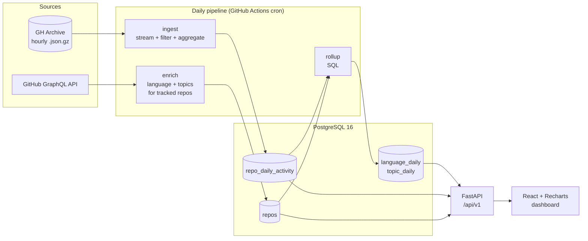

# GitHub Ecosystem Analyzer

Which languages and topics on GitHub are gaining or losing momentum?

This project reads all public GitHub activity from [GH Archive](https://www.gharchive.org/) (stars, forks, pushes, PRs and issues opened), aggregates it per repo per day, rolls it up by language and topic, and serves a dashboard that ranks technologies by momentum, the growth in activity over the last 30, 60 or 90 days compared with the period before.

> Status: early development (M1). See [docs/SPEC.md](docs/SPEC.md) for scope, data model, API and milestones.

## Architecture



## How momentum is computed

```
activity  = stars + 2·forks + 0.5·pushes            (per day, summed per language/topic)
momentum  = (activity last W days − activity previous W days) / max(previous, floor)
```

`W` is 30, 60 or 90 days. The weights are a v1 starting point and get validated against real data in milestone M3 (see [SPEC §4](docs/SPEC.md#4-momentum-score)).

## Stack

| Layer | Tech |
|---|---|
| Ingestion | Python 3.12 scripts, scheduled with GitHub Actions |
| Database | PostgreSQL 16 (Docker locally) |
| API | FastAPI, psycopg 3, raw SQL |
| Frontend | React, Vite, TypeScript, Recharts |
| Quality | pytest, ruff |
| Deploy | Docker → Fly.io or Render |

## Local development

_Setup instructions land with M1._ Prerequisites: Python 3.12, Docker Desktop, Node 20+.

The enrichment step needs a GitHub token in the `GITHUB_TOKEN` environment variable. A fine-grained token with public read-only access is enough. Put it in `.env`, which is git-ignored, and never commit it.

## Roadmap

- [ ] **M1** Ingest pipeline: GH Archive → `repo_daily_activity`
- [ ] **M2** Enrichment + language/topic rollups + momentum query
- [ ] **M3** JSON API + validating the momentum weights
- [ ] **M4** Dashboard
- [ ] **M5** Deploy + daily schedule
